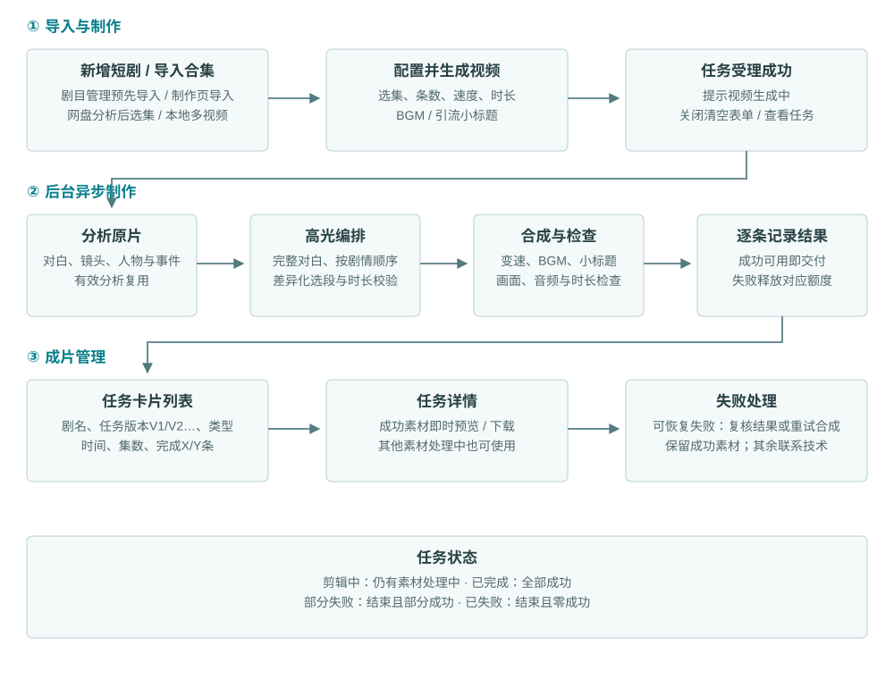

# 智能混剪 · V7 首版需求说明

更新：2026-10-27。本版只提供**高光顺剪**；AI解说放到后续版本。逐字段规则见原型右侧说明，两者同步维护。

## 01. 页面与业务流程

入口：容量万相 → 工具箱 → 智能混剪，新开页面；沿用平台账户和积分。

**手填剧名、选择业务类型，通过网盘选集或本地视频导入原片 → 配置选集、条数、时长、速度与包装 → 提交生成 → 提示视频生成中 → 关闭后清空制作表单 → 成片管理任务列表 → 任务详情 → 成功素材预览、下载。**

- 剧目管理可通过“新增短剧”预先导入片源；查看进入成片管理并自动筛选该剧，新建剪辑带入片源与参数。
- 成片管理以任务卡片展示每次提交；任务详情只列成功素材。制作中也可以使用已成功的素材，失败统一提示联系技术。
- 片源、任务和成片使用稳定身份关联；同名国内/海外合集不合并。关联ID仅用于后台，剧目列表和搜索不展示合集ID。

## 02. 制作素材

### 片源与选集

- 片源卡片显示封面、剧目名称及一个来源标签（国内合集/海外合集/本地上传），不展示剧情描述、可用性概述和原片版本标签。

- 制作页统一“导入合集”，更换也打开同一弹窗；网盘导入/本地上传两个Tab，默认网盘。切换保留共用信息与各自草稿，仅提交当前方式。短剧名称手写必填1～80字；业务类型必选国内短剧/海外短剧，默认空。
- 网盘链接必填，完整分享内容含提取码，不设独立提取码。
- **分析链接：**校验链接格式后请求网盘文件信息，分析结果展示在下方。
  - **分析中：**按钮文案展示分析中，不可重复点击和导入。
  - **成功：**成功显示剧集列表及选集；仅解析文件信息，不启动剧情分析、生成任务或扣积分。
  - **失败：**链接无效、分享失效、提取码错误、无权限、空目录、集号无法识别、超时/服务异常，显示对应提示；可重新点击分析链接。
- 列表按原集号展示文件名、可用/选中状态及已识别数量；默认选择首个连续可用片段（最多30集），支持有效的前10/20/30及全部快捷选择。起止为正整数、范围完整可用；缺集、越界或不可用时禁止导入。无法识别或重复集号时报错，不猜集序。
- 修改分享内容（含提取码）清空结果与选集，须重新分析；重新分析、关闭弹窗后旧响应不回填。切换本地/网盘保留各自草稿，分析中不可切换。
- 分析结果、名称、业务类型及选集有效后导入所选文件，成功关闭并提示“已导入所选剧集”；制作页回填片源与选集、保留其他配置，剧目管理入口仅保存新剧。提交失败保留输入和结果，取消不改原片源。
- 后台继续获取原片，剪辑任务等待就绪再做剧情分析；文件信息分析不等于视频已下载或时长完整，未取得时长仍显示原费用提示。获取失败按生成异常处理，成功受理后的导入不因离开页面取消。
- 本地上传支持多选、追加、删除、上移/下移，每视频为一集；列表展示集序、文件名、时长/大小及读取状态。至少1个文件且全部成功方可导入，失败可重试或删除；取消不改原片源。本地同样保存手写名称与业务类型，不用文件名覆盖剧名。
- 同名剧按资产身份区分，文件内容指纹识别完全重复；分析只复用有效结果。历史绿台/本地剧目和任务保留，本地剧目可继续添加视频，保持名称、业务类型和身份不变。
- 网盘支持平台、目录层级和超大合集上限需研发核定；失效分享、码错误、空目录、非视频、缺集、重号及无权限明确报错，不猜集序。网盘分享凭据不进入公开说明、日志或成片元数据。

### 制作设置

- **必填标识：**必填配置统一在字段名前以红色*（#FF0000）标注，有默认值仍标注；BGM、小标题开关为可选，开启后对应音量、标题文字及样式参数必填。网盘/本地导入及手动选曲沿相同标识，不改变已有校验。

- **制作方式：**固定高光顺剪，原声保留，不生成解说或配音。
- **生成条数：**必填整数1～20，默认10；支持加减和5/10/20快捷值，快捷选项紧邻数量输入框。
- **成片速度：**0.8×、1×、1.1×、1.2×、1.5×，默认1.5×；保音调变速。
- **最终成片时长：**最短和最长均可编辑，默认3～5分钟，当前原型范围10秒～20分钟。支持秒/分单位、加减、双端滑块；以整秒保存，分钟输入可小数，换算四舍五入到秒。切单位不改变实际秒数。
- **时长约束：**10秒≤最短≤最长≤20分钟，两端包含边界。滑块不交叉；数值输入允许修改中暂不合法，显示错误且禁用生成。快捷10–30秒、30–60秒、1–5分钟、2–10分钟、5–12分钟同步两端。
- **时长口径：**变速后的整条视频。无法在区间内保留完整对白和情节时提示内容不足，不截断句子、重复画面或超长交付。

### 包装设置

- **BGM：**默认关闭；勾选后打开选曲弹窗，仅系统曲库、本地上传两种方式。首次打开系统曲库，不默认选曲，选定有效曲目后启用。曲库来源：工具箱 → 小说转投放素材 → 解说素材 → BGM → 平台素材。本批各条使用同一首已选曲目，混音避让人声。
- **BGM音量：**启用后可用滑块/数字双向调节，必填整数0～100%，步长1%，默认20%；0%静音、100%原始增益，只影响BGM。试听沿用音量；更换曲目不重置，空值/越界/小数禁止生成。混音人声期间进一步压低，不提高基础音量。
- **引流小标题：**默认关闭，开启后显示文字及样式；文字去首尾空白后必填、最多24字。固定使用主平台系统商用字体，不提供字体选择；位置改为横向/纵向调节，不提供置顶/置底枚举。
- **字体颜色 / 描边颜色：**独立单选黑/白/黄/绿/粉/蓝，默认黄字、粉色描边；复用平台色板，选中项显示勾选及高亮。
- **描边宽度 / 字号 / 行间距：**滑块和输入双向联动，均整数步长1；范围分别0～6px、12～36px、0～20px，默认2px、22px、0px。0描边不描边；行间距在1.2倍字号的行高上增加。
- **标题宽度：**整数50～100%，默认80%，相对于安全区；居中排字，按宽度换行，不截断文字。
- **横向 / 纵向位置：**整数0～100%，默认50%/8%；在安全区剩余可移动空间中，横向0靠左、50居中、100靠右；纵向0靠上、100靠下。按完整标题块定位，换行不溢出；宽度100%时横向无移动空间，值保留。
- **预览与校验：**八个样式参数均即时预览、保存草稿；滑块/输入步长1，空值/小数/越界就近提示并禁生成。像素以320px宽画面为基准，按最终画面宽同比缩放；四周3%安全区。字体及版本与主平台渲染一致。
- **参数保存：**BGM音量与标题样式随任务保存，不改历史成片。关闭小标题保留参数、不渲染且不校验；提交成功并关闭提示后恢复默认并关闭。旧置顶/置底草稿迁移为横向50%、纵向8%/92%。
- 不提供字幕配置，保留原片画面已有字幕，不做擦除或新增对白字幕。
- 预计成片结构随条数、时长、速度、片源及包装变化；这里只读展示当前配置，不代表已生成结果。

## 03. 生成视频的系统处理

1. **接受任务：**复核提交信息、参数和平台账户；网盘先分析链接确认选集，未完成的导入先等待后台获取并验证原片、选集及权限，成功后才进入分析；保存配置与生效费率快照，返回数字任务ID，重复请求幂等。
2. **识别片源：**ASR识别完整对白及时间码，镜头检测与视觉模型识别人物、动作和场景。只补充新增或失效分析。
3. **理解与选高光：**逐集归纳后整合所选集事件，结合对白、画面、人物关系和前后因果识别冲突、反转及悬念。记录源集数和时间码，不引用选集外事实，不靠单一关键词决定。
4. **按序编排：**以高光为切入点，按原剧情顺序衔接必要情节、压缩冗长过渡、保留完整问答并悬念收尾；按速度校验最终时长。按开头、事件及实际选段排重，只换BGM/标题不算新素材。
5. **渲染与检查：**常规视频服务按时间码切拼、保音调变速、混音及叠加标题；检查吞字、黑屏卡帧、音画同步、时长与重复。自动补救后仍不合格，不记为成功。
6. **逐条交付：**成功输出可用MP4后即可预览、下载并结算该条制作费，失败释放对应冻结积分。未结束保持剪辑中，全部结束按成功数量归为已完成、部分失败或已失败。

可生成M条不足请求N条时不重复凑数：按可制作条数冻结、成功条数结算，按平台生效费率和实际工作量结算，不以参考单价当作准确积分报价。M>0正常交付成功素材，结束显示部分失败；M=0显示已失败，不收制作费。分母保持请求N条。

模型品牌和部署方式由研发结合样片、速度及成本选型；产品验收关注事实可追溯、顺序连贯、对白完整、时长达标和批量差异。

## 04. 剧目管理

- **筛选项：**剧目名称；业务类型为全部业务类型（默认）、国内短剧、海外短剧，条件取交集。按导入时保存的业务类型筛选，网盘和本地上传均适用；历史绿台沿原分类，历史本地无类型的仅在全部下展示。
- **列表项：**剧目名称与封面、集数、制作任务、成片数量。网盘及新本地导入读手写名称、首个导入视频首帧和实际导入集数；新网盘导入显示已确认的集数，历史未取得集数时为“—”，不虚构封面或时长；网盘按业务类型归入国内/海外合集，本地归入本地上传。历史剧目保留原名称与封面，统一支持重命名。
- **计数：**接受一次新任务＋1，原任务失败重试不加；成片计全部任务成功的独立素材数，不重复计算版本。
- **操作项：**查看进入成片管理并应用该剧筛选；新建剪辑带入该剧进入制作页；所有剧目均支持重命名，去空白后1～80字，同步列表、筛选及当前制作片源名称，新任务使用新名称；不改原文件、历史任务和素材名。
- **新增短剧：**放在筛选区下方、列表上方右侧，复用制作页导入合集弹窗。网盘/本地导入成功留在列表，清空筛选展示新剧，任务与成片均为0；不自动分析、制作或扣积分，不覆盖制作页草稿。取消不新增，失败保留输入。后续点该剧“新建剪辑”带入片源。
- 行操作同行，不设汇总或状态筛选。

## 05. 提交反馈、任务列表与详情

### 提交反馈

- 成功受理并返回任务ID后弹窗：“视频生成中，稍后可前往成片管理查看任务进度。”接受即保存输入快照，后台分析/制作不依赖当前表单。
- **继续制作 / 关闭：**清空当前片源、选集、条数、成片速度、时长区间、BGM及小标题，保留已归档剧目与历史任务；必填未设置禁生成。制作方式仍固定高光顺剪。
- **查看任务：**同样清空当前表单，进入新提交任务详情。离开页面不取消后台任务。
- 提交期间防重复点击。同请求幂等；提交失败保留全部输入，响应未知先按请求标识确认受理情况，不能重复建任务。

### 成片管理任务列表

- **筛选项：**剧目（默认全部，来自剧目管理时自动应用该剧）、剪辑类型（全部/高光顺剪）、剪辑状态（全部/剪辑中/已完成/部分失败/已失败）；条件取交集，查询生效，重置恢复全部。
- **剧名：**提交时名称快照。**任务版本：**V1、V2…，对应第1、2…次制作，按同一剧目资产累计，接受新任务加1；同名不同资产不合并，提交失败不加1。
- **剪辑类型：**高光顺剪。**创建：**服务端接受时间。**完成：**本轮全部处理结束时间，剪辑中为“—”，历史缺失不虚构；北京时间到秒。
- **集数：**第X～X集，包含首尾。**已完成X/Y条：**X为成功可用条数，Y为提交条数；失败/不足条数不计成功，也不降低分母。
- **状态：**仍有等待/制作中素材为剪辑中；全部成功为已完成；本轮已结束且部分成功为部分失败；本轮已结束且零成功为已失败。
- **操作项：**查看详情进入任务详情。移除独立制作进度抽屉。

### 任务详情

- 顶部展示任务卡片同样的信息与口径；返回列表保留筛选和页码。
- 成功素材列表：素材名称（点击打开预览弹窗）、实际时长；操作列仅下载，不另设预览按钮。每条成功且媒体就绪即可使用，其他素材仍在制作或失败均不阻塞；不设失败素材占位行。
- 素材名称：**提交时剧名_高光顺剪_提交日期_v任务版本_两位素材序号**。如重逢时她已是王牌_高光顺剪_20261021_v1_01；日期为北京时间YYYYMMDD，跨日完成不改日期；v1对应任务V1，序号从01起，失败不重排。生成后固定，剧目改名不影响；点击名称打开该素材预览弹窗。
- **异常提示：**有可点击的重试按钮时，全部失败显示 **生成异常，请点击“重试”**，部分失败显示 **部分生成异常，请点击“重试”，继续生成剩余的成片。**；重试中显示“正在重试，请稍候”。无可重试项时，才分别显示“生成异常，请联系技术排查”/“部分生成异常，请联系技术排查”。成功素材始终可用；不展示失败明细或勾选列表。
- 暂无成功素材：制作中显示“视频生成中，成功素材将显示在这里。”；结束后显示“暂无成功素材”。有成功素材时正常提供预览与下载。
- 本次不提供单条/批量同步、人工确认和同步记录。

### 可恢复失败重试

- **入口：**任务卡片及详情操作区显示“重试”，仅服务端明确判定可恢复时展示；未知错误、原结果缺失或不可恢复失败继续联系技术，不猜测可重试性。
- **分析结果解析/校验失败：**读取该任务已有分析结果，重新解析并校验完整性、结构、选集与时间码；通过后继续剪辑。再次校验失败则保留失败，不重新调用模型、不自动补造剧情。
- **成片合成失败：**复用原分析、剪辑方案、参数与资源，只提交中断、超时、临时读写异常等可恢复失败项。10条成功8条、失败2条时仅重试符合条件的失败项；成功8条不重做，始终可预览下载。
- **过程与结果：**提交后剪辑中、“重试中”按钮禁用；结束后更新成功数、状态与本轮完成时间。沿用任务ID/V版本/提交总数及素材序号；成功视频、名称、链接不变。还有可恢复失败可再试；其余仍联系技术。
- **防重：**服务端受理时复核资格、按任务/失败项加锁并幂等；超时先查询受理结果，刷新接续同一任务，不重复启动。
- **费用：**已成功素材不重做、不重复扣费；失败的素材重试后不新增收费。

## 06. 视频预览

- 点击素材名称，在当前任务详情上打开预览弹窗；顶部显示名称（过长省略、悬停看全文）与关闭按钮，主体只保留播放器。
- 黑底按原比例完整显示视频，竖屏居中留黑；默认暂停、从0开始。支持播放/暂停、进度拖动、当前/总时长、音量/静音及全屏；播放结束可重播。
- 关闭或Esc停止播放，保留原列表滚动位置、筛选和页码；再次打开从0开始。全屏中Esc先退出全屏；点击遮罩不关闭。
- 媒体加载中显示播放器反馈；失败在播放区提示“视频加载失败，请关闭后重试”，保留关闭入口，不替换其他素材。
- 不展示问题反馈、问题记录、相似素材、制作参数、上下条或下载按钮；下载在任务详情列表完成，不改变后台生成和技术排查记录。

## 07. 本版范围

仅高光顺剪、原片导入与复用、异步任务管理、成功素材预览/下载。本次不做单条/批量同步、失败明细；仅开放上述可恢复失败重试。AI解说、投放系统对接、评分回传及更细的异常处理后续评估。

## 08. 积分、验收与范围

- **预估积分消耗：**所选各集时长完整、计费参数有效时展示“预估积分消耗 X 积分”。剧目管理新建剪辑使用已有片源信息，网盘解析完成后同样展示；按数据是否完整判断，不按入口判断。选集/条数/时长/速度变化后更新报价，信息或参数不完整不显示0积分或旧报价。仅只读展示本次新增分析与制作的预估总积分，数值不可点击，不展示费用拆分或明细弹窗。
- **未取得时长：**网盘显示“当前未拿到原片总时长，所以积分预估不准，预计原片分析成本0.5元/分钟，具体积分消耗以平台实际扣费记录为准。”本地信息不完整提示暂无法预估，不按集数猜时长。
- **费用口径：**0.5元/分钟仅为原片分析参考成本，不代表每条成片总价。积分兑换、生效费率与实际流水沿用平台，不能自行将元等同积分；新导入本身不启动分析或扣积分。

有效新增分析完成后结算，缓存复用免费；首次制作按实际条数冻结额度，逐条成功结算、失败释放。已成功素材不重做、不重复扣费；失败素材重试不新增收费，不再次冻结额度；重试再次失败不重复释放已退额度。预览和下载不收制作费。费率和余额沿平台，不另建账户或兑换体系。

服务端持久任务不随关页/熄屏停止；刷新读取现有进度，输入快照、任务/素材身份、费用均需防重复。

验收重点：新增短剧导入后留在列表、零任务/零成片、保留制作草稿；已知时长的预估总值、选集/参数联动、网盘未知时长提示；导入双方式与业务类型、时长与速度校验；提交成功提示与全部表单清空、提交失败保留；同剧任务版本累计、同名不同资产区分；剪辑中/全成功/部分失败/全失败与分析失败；已成功素材即时预览下载；部分/全部异常提示与可恢复重试、无同步入口；分页、筛选、详情返回和刷新进度。

当前时长默认/上下限参考竞品交互及既有默认，正式上线前随样片与算力确认；积分费率、输入规模/格式、并发、耗时、相似阈值、曲库授权及保存期由业务与研发核定。国内0.6元/条为业务成本目标，尚非实测承诺。AI解说、投放评分回传放入后续版本。
